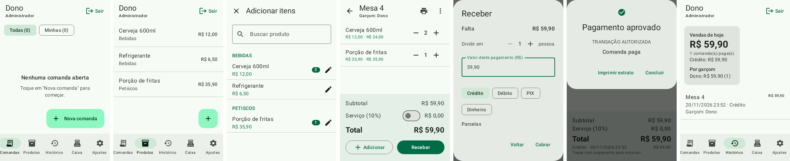
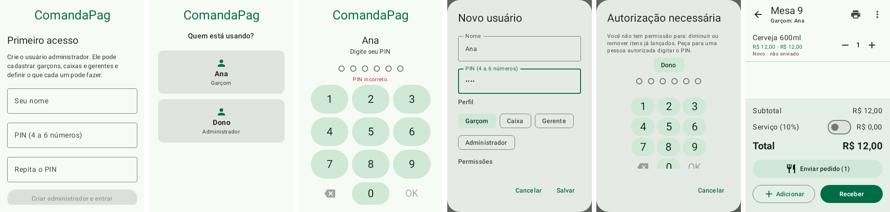
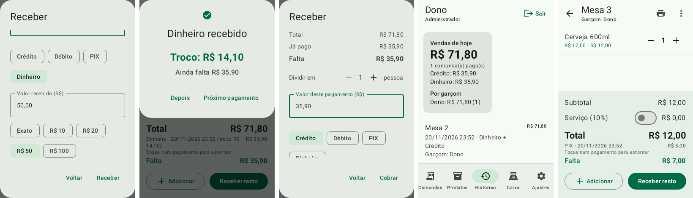
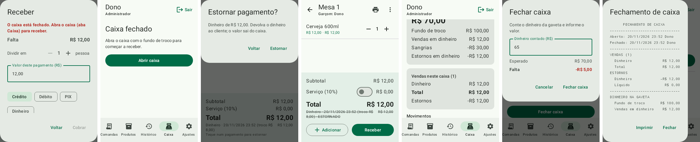

# comandaPag

App de **comandas** para bares, lanchonetes e restaurantes que roda direto na
maquininha **PagBank Smart 2** (Android) e cobra pela própria maquininha usando a
biblioteca oficial [PlugPagServiceWrapper](https://github.com/pagseguro/pagseguro-sdk-plugpagservicewrapper).









*Capturas geradas pelo teste de interface com a maquininha simulada.*

## Funcionalidades

- **Produtos**: cadastro do cardápio (nome, preço e categoria).
- **Comandas**: abrir por número, mesa ou nome do cliente; lançar itens com
  quantidade e observação; alterar/remover itens; taxa de serviço de 10% opcional.
- **Cobrança na maquininha**: crédito (à vista ou parcelado em até 12x), débito e PIX.
- **Dinheiro com troco**: informe quanto o cliente entregou (atalhos de R$ 10, 20,
  50 e 100) e o app mostra o troco.
- **Dividir a conta e pagamento misto**: a comanda aceita vários pagamentos, em
  formas diferentes (ex.: parte no PIX, parte em dinheiro, o resto no crédito).
  Em "Dividir em N pessoas" o app sugere o valor de cada um, distribuindo os
  centavos para fechar exato. A comanda só fecha quando não falta nada; a tela
  mostra "Pago" e "Falta". Depois de receber parte, não é possível remover itens
  abaixo do valor já pago nem cancelar a comanda.
- **Estorno**: toque num pagamento da comanda para estorná-lo. Cartão e PIX são
  estornados na maquininha; dinheiro é devolvido do caixa. Se a comanda já estava
  paga, ela volta a ficar aberta. O pagamento estornado fica riscado (auditoria).
- **Caixa**: abertura com fundo de troco (só é possível receber com o caixa aberto),
  sangria e suprimento com motivo, e fechamento: você informa o dinheiro contado
  na gaveta e o app mostra sobra ou falta. Relatório de fechamento impresso com
  vendas por forma, estornos, sangrias e suprimentos.
- **Impressão**: extrato da comanda na impressora térmica da Smart 2.
- **Histórico**: comandas pagas/canceladas e resumo das vendas do dia por forma de pagamento.
- **Garçom responsável**: cada comanda guarda quem abriu e quem fechou (cobrou ou
  cancelou). Aparece na lista, na comanda, no extrato e no histórico, que mostra
  as vendas do dia por garçom. Filtro "Minhas / Todas" na lista de comandas.
- **Login com PIN e permissões**: cada pessoa entra com seu nome e PIN (4 a 6
  números). As permissões são individuais, com perfis prontos:

  | Permissão                         | Garçom | Caixa | Gerente | Administrador |
  |-----------------------------------|:------:|:-----:|:-------:|:-------------:|
  | Abrir comanda e lançar itens      | ✔      | ✔     | ✔       | ✔             |
  | Cobrar na maquininha              | ✔      | ✔     | ✔       | ✔             |
  | Diminuir/remover itens            |        |       | ✔       | ✔             |
  | Cancelar comanda                  |        |       | ✔       | ✔             |
  | Ligar/desligar 10% de serviço     |        |       | ✔       | ✔             |
  | Ver histórico e vendas            |        | ✔     | ✔       | ✔             |
  | Estornar pagamentos               |        |       | ✔       | ✔             |
  | Abrir/fechar caixa, sangria       |        | ✔     | ✔       | ✔             |
  | Cadastrar produtos                |        |       | ✔       | ✔             |
  | Cadastrar usuários e permissões   |        |       |         | ✔             |
  | Ajustes e ativação da maquininha  |        |       |         | ✔             |

  Quando alguém tenta uma ação sem permissão (ex.: garçom removendo um item), o app
  pede o **PIN de uma pessoa autorizada**, como o gerente. O PIN é guardado só como
  hash (SHA-256 com salt); 5 erros seguidos bloqueiam o usuário por 30 segundos.
  No primeiro uso o app pede para criar o administrador.
- **Ajustes**: troca do próprio PIN; nome do estabelecimento (sai no extrato),
  taxa de serviço padrão e ativação da maquininha.
- Funciona **offline**: os dados ficam no banco local (Room/SQLite) da maquininha.

## Estrutura do projeto

```
core/   Regras de negócio em Kotlin puro (sem Android) + testes
        ├─ modelo/       Produto, Comanda, ItemComanda, Pagamento, Dinheiro
        ├─ servico/      ComandaService (comandas) e UsuarioService (login, PIN, permissões)
        ├─ seguranca/    Hash do PIN
        ├─ pagamento/    Interfaces TerminalPagamento e Impressora
        ├─ repositorio/  Interfaces de persistência
        └─ impressao/    ExtratoComanda (texto do cupom em 32 colunas)
app/    App Android (Jetpack Compose + Room)
        ├─ src/main       Telas, banco de dados, renderização do cupom
        ├─ src/smart      Integração real com o PlugPag (PagBank)
        ├─ src/simulador  Maquininha simulada para emulador/celular
        └─ src/testSimulador  Teste de interface do fluxo completo (Robolectric)
```

O app tem dois *flavors*:

| Flavor      | Onde roda               | Cobrança                                    |
|-------------|-------------------------|---------------------------------------------|
| `smart`     | PagBank Smart 2         | Real, via PlugPag                           |
| `simulador` | Emulador ou celular     | Simulada (valores terminados em ,99 são recusados, para testar o erro) |

## Como compilar

Requisitos: Android Studio (ou JDK 17+ e Android SDK 35).

```bash
# Testes das regras de negócio
./gradlew :core:test

# APK para testar no emulador/celular (sem cobrança real)
./gradlew :app:assembleSimuladorDebug

# APK para a maquininha PagBank Smart 2
./gradlew :app:assembleSmartDebug

# Teste de interface do fluxo completo (gera capturas de tela em app/build/capturas)
./gradlew :app:testSimuladorDebugUnitTest
```

Os APKs ficam em `app/build/outputs/apk/<flavor>/debug/`.

## Instalando na Smart 2

A PagBank só permite apps de terceiros nas maquininhas depois de **homologação**:

1. Desenvolva e teste com o flavor `simulador` no emulador/celular.
2. Peça à PagBank, pelo portal de desenvolvedores, um terminal de
   **desenvolvimento** (ou a liberação do seu para depuração).
3. Instale o APK `smart` com `adb install` nesse terminal e teste pagamentos reais.
4. Envie o APK `smart` (release, assinado) para homologação. A PagBank distribui
   o app para as maquininhas.

## Detalhes da integração PagBank

- A biblioteca vem do repositório Maven da PagBank, configurado em
  `settings.gradle.kts` (versão `1.35.0`).
- A permissão `br.com.uol.pagseguro.permission.MANAGE_PAYMENTS` é adicionada
  automaticamente pelo manifesto da biblioteca.
- Os valores vão em centavos; a referência da venda é `CMD<id da comanda>`
  (a PagBank limita a 10 caracteres).
- A via do estabelecimento é impressa pela própria PagBank (`printReceipt = true`);
  o extrato da comanda é impresso pelo app como imagem (`printFromFile`).
- Toda a integração está em `app/src/smart/kotlin/br/com/comandapag/terminal/PlugPagTerminal.kt`.
